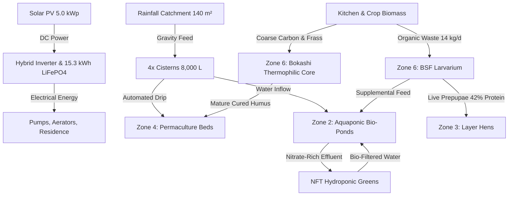

# TERRA INTERFACE — Personal Self-Sustaining Home OS

> **"Your Home. Your Resources. Your Ecosystem."**  
> First Canonical Implementation: **Vincent's Farm (300 m² Homestead, West Java, Indonesia)**

---

## 🌿 Overview

**Terra Interface** is a modular, regenerative Home Operating System (Home OS) designed for personal homestead autonomy, bio-physical resource tracking, and circular ecological management. 

Operating on a canonical 300 m² site plan in West Java, Indonesia, Terra Interface balances 7 spatial zones across water catchment, photovoltaic microgrid energy, livestock, aquaculture, permaculture cultivation, and biological bioconversion.



---

## 🏛️ Architecture & Workspace Structure

Terra Interface is organized as a decoupled monorepo containing the **Console Web Client** and the **Core Domain Engine**:

```
terra-interface/
├── console/                        # Frontend Web Console Application (Next.js 14)
│   ├── components/                 # Global UI Components & Isometric 3D Visual Models
│   │   ├── isometric/              # Isometric Homestead 300 m² & Resource Flow SVGs
│   │   ├── MainLayout.js           # Light Nature Theme Shell, Breadcrumbs & Header
│   │   └── MenuBar.js              # Horizontal Navigation & Live Telemetry Pulse
│   ├── features/                   # Domain-Specific Feature Modules & Contextual Drawers
│   │   ├── cultivation/            # Add Batch, Log Growth Stage Drawers
│   │   ├── livestock/              # Daily Egg Collection, Animal Health Drawers
│   │   ├── aquaculture/            # Water Quality Test, Fish Feeding Drawers
│   │   ├── circular/               # BSF Feed, Maggot Harvest, Bokashi Turn Drawers
│   │   ├── inventory/              # Record Stock In/Out, Stock History Drawers
│   │   ├── microgrid/              # Dispatch Policy & Manual Ingestion Drawers
│   │   └── intelligence/           # Foliage Diagnosis & Autonomy Audit Drawers
│   ├── hooks/                      # Custom React Hooks (SWR, Microgrid Telemetry SSE)
│   ├── pages/                      # Next.js Application Routes (10 Static Pages)
│   │   ├── index.js                # 01. Overview (Homestead real-time health pulse)
│   │   ├── map.js                  # 02. Map (Interactive 3D site plan & 7 zones)
│   │   ├── production.js           # 03. Production (Yield curves & multi-harvest logs)
│   │   ├── resources.js            # 04. Resources (Microgrid, water tanks & pantry)
│   │   ├── activities.js           # 05. Activities (Daily chore schedule & work orders)
│   │   ├── intelligence.js         # 06. Intelligence (Terra AI Assistant & Autonomy)
│   │   └── operations/             # 07. Operations (Universal tabular ledger management)
│   ├── services/                   # Typed API Client & REST Service Layer
│   ├── styles/                     # Global Nature-Tech Styles & Typography
│   └── theme/                      # Light Nature MUI Design System (#1B4332, #FAF9F5)
│
├── core/                           # Backend Modular Monolith & Domain Engine (NestJS 10)
│   ├── prisma/
│   │   ├── schema.prisma           # 12-Domain Normalized Relational Schema
│   │   └── seeders/                # Deterministic Seeders for Vincent's Farm (300 m²)
│   ├── src/
│   │   ├── helpers/                # Ecological & Biotechnical Helper Algorithms
│   │   ├── modules/                # Domain Modules with DTOs & Swagger Docs
│   │   │   ├── universal-batch/    # Batch State Machine & Multi-Harvest Registry
│   │   │   ├── spatial/            # 7 Spatial Zones & Facilities Management
│   │   │   ├── catalog/            # Dynamic Taxonomy & Unit Conversion Matrix
│   │   │   ├── cultivation/        # Crop Cycles, Stage Logging & Harvests
│   │   │   ├── livestock/          # Poultry Batches & Hen-Day Egg Production
│   │   │   ├── aquaculture/        # Nile Tilapia & Catfish FCR and Water Testing
│   │   │   ├── circular/           # BSF Bioconversion & Bokashi Thermophilic Compost
│   │   │   ├── inventory/          # Immutable Double-Entry Ledger & Overdraft Shield
│   │   │   ├── energy-water/       # Real-Time SSE Telemetry & Protection Rules
│   │   │   └── intelligence/       # Terra AI Autonomy Engine & Botanical Diagnosis
│   │   ├── app.module.ts           # Root Module
│   │   └── main.ts                 # Bootstrap Entry Point (Port 4000, Swagger /api/docs)
│   └── test/                       # Invariant Verification Test Suites
│       ├── circular-inventory-invariants.test.ts
│       ├── microgrid-telemetry-invariants.test.ts
│       └── intelligence-autonomy-invariants.test.ts
│
├── docs/                           # Master Architectural & Technical Specifications (12 docs)
│   ├── architecture-overview.md    # High-level system context, boundaries, and principles
│   ├── console-architecture.md     # Next.js feature architecture & embedded CRUD drawers
│   ├── core-architecture.md        # NestJS domain modular monolith & Swagger specifications
│   ├── canonical-homestead-model.md# Vincent's Farm 300 m² Master Plan specifications
│   ├── database-erd.md             # Complete Mermaid Entity-Relationship Diagram (12 domains)
│   ├── batch-engine-spec.md        # Universal batch state machine & multi-harvest rules
│   ├── product-unit-catalog-spec.md# Product taxonomy and dimension-safe unit conversions
│   ├── resource-flow-spec.md       # Directed circular loops & mass/energy balance equations
│   ├── inventory-ledger-spec.md    # Immutable double-entry stock movement ledger spec
│   ├── api-contracts.md            # Complete /api/v1/ REST endpoint inventory & DTO schemas
│   ├── migration-plan.md           # Zero-downtime database and code migration protocols
│   └── implementation-roadmap.md   # Prioritized milestone roadmap & acceptance criteria
│
├── package.json                    # Root Workspace Configuration & Scripts
└── README.md                       # Main Project Documentation
```

---

## ⚡ Core Homestead Capabilities

### 1. Universal Batch State Machine & Operations
- Unified lifecycle tracking for plants, poultry, aquatic species, and bioconverters (`DRAFT` $\to$ `PLANNED` $\to$ `ACTIVE` $\to$ `HARVESTING` $\to$ `COMPLETED`).
- Support for **multi-harvest continuous production** (e.g., daily egg collection, successive vegetable flushes).
- Automated biological metrics: **Hen-Day Egg Production Rate (%)** and **Feed Conversion Ratio (FCR)**.

### 2. Circular Bioconversion & Immutable Inventory Ledger
- **Black Soldier Fly (BSF)** bioconversion yielding 3.2 kg/day live prepupae (42% crude protein) with 65/35 feed allocation for layer hens and tilapia.
- **Bokashi Composting** tracking thermophilic pasteurization (64°C) and weed seed inactivation.
- **Double-Entry Ledger**: Stock balances mathematically derived via $\sum \Delta_{\text{quantity}}$ with automatic intake from harvests and strict overdraft protection.

### 3. Real-Time Microgrid & IoT Telemetry Gateway
- **Server-Sent Events (SSE)** via `@Sse('telemetry/stream')` with REST fallback.
- Ingestion endpoint for ESP32 edge probes across Zone 2 (DO, pH) and Zone 5 (Solar kW, Battery SoC).
- **Automated Protection Rules**:
  - Load shedding alert when battery SoC $< 20\%$.
  - Dump load activation (`EVAPORATIVE_MISTING` / `POND_CASCADE_AERATOR`) during solar surplus $\ge 2.0\text{ kW}$ and battery $\ge 95\%$.
  - Low cistern alert when water buffer $< 2,000\text{ L}$.
  - Emergency aerator alarm when dissolved oxygen $< 5.0\text{ mg/L}$.

### 4. Terra AI Autonomy Engine & Ecological Intelligence
- **Composite Autonomy Index**:
  $$\text{Autonomy} = 0.35 \times \text{Food} + 0.25 \times \text{Water} + 0.25 \times \text{Energy} + 0.15 \times \text{Circularity}$$
- Dynamic recommendation lifecycle with live **Accept & Dispatch** (triggering positive autonomy recalculations) and **Dismiss**.
- **Botanical Foliage Diagnosis**: Inferences for Nitrogen, Potassium, Magnesium, Calcium, and Iron deficiencies from visual symptoms with permaculture remedies.
- **Microclimate Forecast**: Diurnal West Java rainfall windows with roof catchment modeling ($18\text{ mm} \times 140\text{ m}^2 \times 0.85 = 2,142\text{ L}$).

---

## 🚀 Quick Start Guide

### Prerequisites
- **Node.js**: v18.0.0 or higher
- **npm**: v9.0.0 or higher

### 1. Installation
Clone the repository and install all workspace dependencies:
```bash
git clone https://github.com/vincent-guizot/terra-interface.git
cd terra-interface
npm install
```

### 2. Run Frontend Console (`console/`)
```bash
# From workspace root:
npm run dev:console

# Open browser at:
http://localhost:3000
```

### 3. Run Backend Core Engine (`core/`)
```bash
# From workspace root:
npm run dev:core

# Swagger Interactive Documentation:
http://localhost:4000/api/docs
```

### 4. Build Verification
```bash
# Build NestJS Core Engine:
npm run build:core

# Build Next.js Static Console (10/10 pages):
npm run build:console
```

### 5. Run Invariant Verification Tests
```bash
# Circular Systems & Inventory Ledger Invariants:
cd core && npx ts-node test/circular-inventory-invariants.test.ts

# Microgrid Telemetry & Protection Rules Invariants:
cd core && npx ts-node test/microgrid-telemetry-invariants.test.ts

# Terra AI Autonomy Engine & Diagnosis Invariants:
cd core && npx ts-node test/intelligence-autonomy-invariants.test.ts
```

---

## 📊 Invariant Test Results

| Test Suite | File Link | Test Cases | Result |
| :--- | :--- | :---: | :---: |
| **Circular & Inventory** | [`circular-inventory-invariants.test.ts`](./core/test/circular-inventory-invariants.test.ts) | 7 / 7 | ✅ Passed |
| **Microgrid & Telemetry** | [`microgrid-telemetry-invariants.test.ts`](./core/test/microgrid-telemetry-invariants.test.ts) | 7 / 7 | ✅ Passed |
| **Terra AI & Autonomy** | [`intelligence-autonomy-invariants.test.ts`](./core/test/intelligence-autonomy-invariants.test.ts) | 7 / 7 | ✅ Passed |
| **Core Build** | `npm run build:core` | NestJS Build | ✅ Exit 0 |
| **Console Build** | `npm run build:console` | 10 Static Routes | ✅ Exit 0 |

---

## 📄 License & Attribution

Developed by **Vincent Guizot** as an open-source, reproducible Personal Home Operating System for regenerative, self-sustaining homesteads.
Distributed under the **MIT License**.
