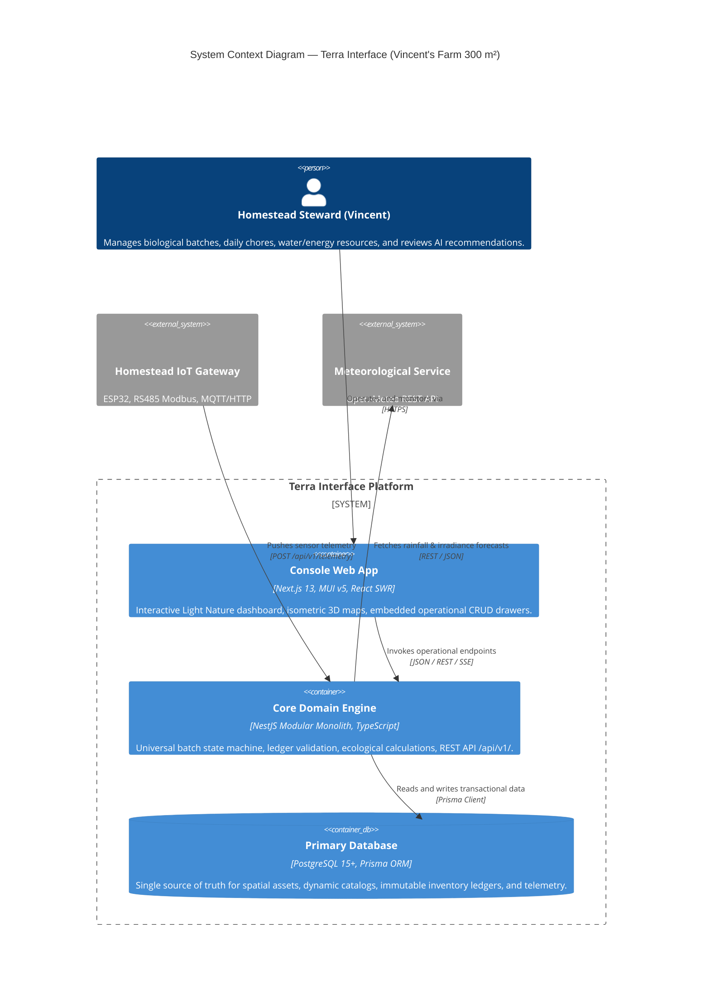

# Architecture Overview — Terra Interface

> **Personal Self-Sustaining Home Operating System (Home OS)**  
> **First Implementation**: Vincent's Farm (300 m² Homestead, West Java, Indonesia)  
> **Document Version**: 1.0.0 | **Status**: Target Architecture Specification

---

## 1. Executive Summary

**TERRA INTERFACE** is a Personal Self-Sustaining Home Operating System engineered to monitor, automate, and orchestrate high-density regenerative homestead operations. It bridges biological life cycles (crops, poultry, finfish, black soldier flies, aerobic composting) and physical resource microgrids (solar photovoltaic arrays, battery energy storage systems, rainwater catchment, and gravity filtration).

The system is structured as two decoupled applications:
1. **`console/`**: A modern, feature-based Next.js web application built with Material-UI v5, Manrope typography, and miniature isometric 3D illustrations adhering to the Light Nature design philosophy.
2. **`core/`**: A domain-based NestJS modular monolith backed by PostgreSQL and Prisma ORM, executing business rules, state machines, ecological calculations, and telemetry ingestion.

---

## 2. System Context Diagram

---

## 3. Existing Code vs. Proposed Target Architecture

To maintain strict architectural honesty, the platform distinguishes what is currently implemented from what is designed in this specification:

| Layer / Subsystem | Currently Implemented (Verified in Repo) | Proposed Target Architecture |
| :--- | :--- | :--- |
| **Console Pages** | 10 static routes (`/`, `/overview`, `/map`, `/production`, `/resources`, `/activities`, `/intelligence`, `/operations`, `/404`, `/_app`) generating cleanly with Next.js build. | Retained 100%; preserve Light Nature aesthetics and navigation. |
| **Console State** | Monolithic local React state in [operations/index.js](file:///D:/All%20Coding/05%20-%20Applications/Web%20Applications/terra-interface/console/pages/operations/index.js) (1,191 lines) with static fallback mocks. | Decomposed into feature-based modules (`console/features/`) powered by existing custom hooks (`useUniversalBatches`, `useOperationsCRUD`). |
| **Console API Client** | [apiClient.js](file:///D:/All%20Coding/05%20-%20Applications/Web%20Applications/terra-interface/console/services/apiClient.js) catches network errors and returns `null`, prompting mock data generation. | Strict HTTP error propagation with visual offline caching banners. |
| **Core Monolith** | [app.module.ts](file:///D:/All%20Coding/05%20-%20Applications/Web%20Applications/terra-interface/core/src/app.module.ts) imports only `UniversalBatchModule`. Swagger documentation running at `/api/docs`. | Full domain modular monolith importing Cultivation, Livestock, Aquaculture, Circular, Inventory, and Microgrid modules. |
| **Database Schema** | Generic [schema.prisma](file:///D:/All%20Coding/05%20-%20Applications/Web%20Applications/terra-interface/core/prisma/schema.prisma) with generic Batch, Zone, InventoryItem, and StockTx models. | Fully normalized 12-domain schema with 1-to-1 batch details and immutable double-entry `StockMovement` ledger. |
| **Database Seeders** | Verified idempotent seeders for 7 Zones, Production Types, Storage Locations, and initial Batches in [core/prisma/seeders/](file:///D:/All%20Coding/05%20-%20Applications/Web%20Applications/terra-interface/core/prisma/seeders/). | Extended seeders covering full product catalogs, equipment, and circular resource links. |

---

## 4. Key Architectural Principles

1. **Feature-Based Frontend (`console/`)**:
   Frontend code is organized around operational domains rather than technical types. Each domain encapsulates its own components, hooks, and contextual drawers while sharing global UI primitives.
2. **Domain-Based Modular Monolith (`core/`)**:
   Backend logic is separated into autonomous domain modules with clear interfaces. No direct cross-module database writes are allowed; cross-domain coordination occurs via service calls or domain events.
3. **Immutable Inventory Ledger**:
   Stock balances are never directly updated. Every change in stock is recorded as a signed movement with a specific reason, making the inventory balance completely reconstructable at any point in history.
4. **Universal Batch Lifecycle**:
   Every biological organism (kale, chickens, tilapia, BSF larvae) follows a standardized state machine (`DRAFT → PLANNED → ACTIVE → ON_HOLD → COMPLETED / CANCELLED`) extended by domain-specific detail tables.
5. **Zero Hardcoded Biological Configuration**:
   Products, measurement units, and custom telemetry fields are dynamic database records, allowing Vincent's Farm to evolve without schema migrations.
6. **Edge Resilience & Low Latency**:
   Designed to run on low-power local hardware (e.g., Raspberry Pi 5 or Intel N100 mini PC) within the homestead network, operating reliably even during rural internet outages.
