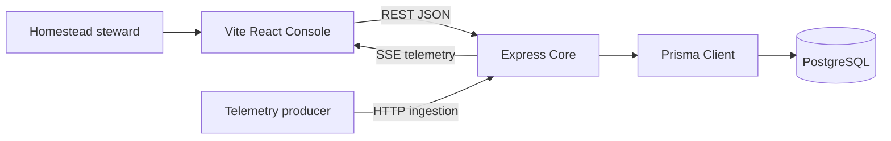

# Architecture overview

Terra Interface is a home operating dashboard and domain API for the Vincent's Farm homestead design. Its current applications are JavaScript projects in an npm workspace:

| Application | Runtime and responsibility |
| --- | --- |
| console/ | Vite, React 18 and React Router SPA; Redux application state, operational views and API clients |
| core/ | Express 4 ES modules; domain services, REST endpoints, telemetry streams and Prisma persistence |
| PostgreSQL | Relational data defined in core/prisma/schema.prisma |

The diagram describes code boundaries, not verified physical device deployment. Redis is available in Docker Compose but is not a required Core dependency. No Swagger server is mounted in the current Express app.

## Runtime boundaries

- Console bootstraps through console/src/app/main.jsx. Application providers, router and Redux are under console/src/app/; reusable UI is under components/ui/, domain views under features/, static data under data/, and reusable functions under helpers/.
- The dev Console port is 3000 and Core defaults to 4000. server.js checks the database before listening; failed connectivity aborts startup.
- Core exports the configured app from core/src/app.js; core/src/server.js listens for connections. core/src/routes/v1/index.js mounts domain routers under /api/v1.
- Domain constants live under core/src/constants/. The Prisma singleton and database URL resolution live in core/src/prisma/prisma.service.js.
- The in-process event bus connects domain listeners; it is not a durable queue and does not provide cross-process delivery guarantees.

## Persistence and contracts

The schema contains 38 models. Per-table seeders read explicit demo JSON and execute in dependency order within a transaction. The REST envelope is documented in [the Core contract](../core/docs/api-response-contract.md); health, SSE and audit export retain separate formats.

Persistence is mixed: several services use Prisma, while others return canonical data or maintain in-memory state. Restarting Core can discard in-memory operations. Treat offline operation, complete durable auditability, authentication and physical automation as requirements to verify per feature, not guarantees of the whole application.

See [setup](getting-started.md), [Console architecture](console-architecture.md), [Core architecture](core-architecture.md) and [remaining work](implementation-roadmap.md).
