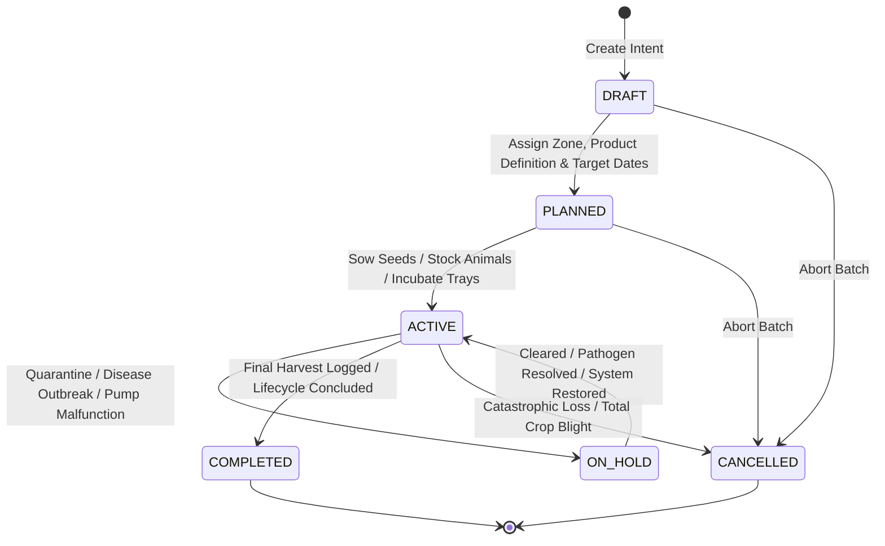

# Universal Batch Engine Specification — Terra Interface

> **Domain Engine Specification**  
> **Backend Service**: `UniversalBatchService` (`core/src/modules/universal-batch/`)  
> **Document Version**: 1.0.0 | **Status**: Verified Specification

---

## 1. Product Vision & Concept

Biological systems on a self-sustaining homestead do not operate as static warehouse items; they exist as living, dynamic cycles of birth, growth, production, and harvesting.

The **Universal Batch Engine** provides a single, uniform abstraction across all biological domains:
- **Cultivation**: Microgreens, hydroponic kale, fruiting oyster mushrooms, orchard trees.
- **Livestock**: Broiler flocks, pastured egg-laying hens, dairy goats, sheep herds.
- **Aquaculture**: Tilapia fingerling grow-outs, African catfish bio-pond cycles.
- **Circular Systems**: 5-tray Black Soldier Fly (BSF) bioconversion batches, Bokashi compost piles.

---

## 2. Universal Batch State Machine

Every biological batch transitions through a deterministic, strictly validated lifecycle:



---

## 3. Transition Validation Matrix

The transition logic is enforced by `UniversalBatchService.transitionStatus`:

| Transition | Allowed? | Pre-Conditions Required | Automated Side Effects |
| :--- | :---: | :--- | :--- |
| `DRAFT` $\to$ `PLANNED` | **YES** | Valid `productDefinitionId`, target `zoneId` assigned. | Initial planning schedule recorded in audit log. |
| `PLANNED` $\to$ `ACTIVE` | **YES** | `initialQuantity` $> 0$; Input stock (seeds, feed, chicks) verified in inventory. | Creates `BATCH_CONSUME_OUT` transaction in `StockMovement`. |
| `ACTIVE` $\to$ `ON_HOLD` | **YES** | Mandatory explanation `reason` provided in DTO. | Flags batch visually in Console UI (warning badge); notifies steward. |
| `ON_HOLD` $\to$ `ACTIVE` | **YES** | Health inspection score confirmed $\ge 80\%$. | Logs resolution event in `BatchStatusHistory`. |
| `ACTIVE` $\to$ `COMPLETED` | **YES** | At least one harvest recorded OR zero active mortality. | Sets `actualEndDate = now()`; calculates final Feed Conversion Ratio (FCR) or yield. |
| `ACTIVE` $\to$ `CANCELLED` | **YES** | Mandatory failure reason (e.g., severe heatwave, blight). | Deducts remaining stock as `MORTALITY_LOSS_OUT`. |
| `COMPLETED` $\to$ *Any* | **NO** | State is immutable once completed. | Throws `422 Unprocessable Entity`. |

---

## 4. Multi-Harvest Architecture

Unlike industrial batch manufacturing where a batch outputs exactly once at the end, biological homestead batches frequently yield **continuous, recurring harvests**:
- **Tuscan Kale (Zone 1)**: Harvested via "Cut-and-Come-Again" weekly for 4 months.
- **Pastured Hens (Zone 3)**: Lay eggs daily across their 18-month productive cycle.
- **Oyster Mushrooms (Zone 1)**: Produce 3 distinct flushes of fruiting bodies per baglog.

### Harvest Logging Flow

```mermaid
sequenceDiagram
    autonumber
    actor Steward as Vincent (Homestead Steward)
    participant Console as Console UI (/operations)
    participant BatchAPI as UniversalBatchController
    participant BatchSvc as UniversalBatchService
    participant InvSvc as InventoryLedgerService
    participant DB as PostgreSQL Database

    Steward->>Console: Clicks "Record Harvest" on Active Batch
    Console->>BatchAPI: POST /api/v1/batches/:id/outputs (qty, unit, grade, destination)
    BatchAPI->>BatchSvc: recordOutput(batchId, dto)
    BatchSvc->>DB: Inserts new BatchOutput record
    BatchSvc->>InvSvc: createMovement(HARVEST_IN, qty, destinationLocationId)
    InvSvc->>DB: Appends StockMovement (+qty)
    BatchSvc->>DB: Appends BatchHistory ("Harvest of 12.0 kg logged by Vincent")
    DB-->>BatchSvc: Transaction committed
    BatchSvc-->>BatchAPI: Returns updated Batch dossier with total yield
    BatchAPI-->>Console: 201 Created
    Console-->>Steward: Table refreshes; aggregate yield updated
```

---

## 5. Domain Detail Extensions (1-to-1)

Each domain attaches specialized biological parameters to the generic `Batch` model via a dedicated 1-to-1 table:

### 1. Cultivation (`CultivationBatchDetail`)
- `growingMedium`: `NFT_SOLUTION`, `LIVING_SOIL`, `SAWDUST_BAGLOG`, `DWC`
- `ecTarget`: Electrical Conductivity target (e.g. 1.6 mS/cm for bok choy).
- `phTarget`: pH target (e.g. 6.2).
- `trayCount`: Number of nursery trays or vertical channels occupied.

### 2. Livestock (`LivestockBatchDetail`)
- `breed`: `Ayam KUB`, `Joper`, `Cornish Cross`, `Garut Sheep`.
- `housingSystem`: `DEEP_LITTER_COOP`, `MOBILE_TRACTOR`, `ELEVATED_SLAT`.
- `mortalityCount`: Cumulative bird/animal losses.
- `targetFcr`: Target Feed Conversion Ratio (e.g. 2.1 for Joper).

### 3. Aquaculture (`AquacultureBatchDetail`)
- `species`: `Oreochromis niloticus` (Nile Tilapia), `Clarias gariepinus` (Catfish).
- `pondVolumeM3`: Water volume in cubic meters.
- `targetDensityKgM3`: Maximum stocking biomass density (e.g. 25 kg/m³).
- `dissolvedOxygenMin`: Minimum dissolved oxygen threshold (mg/L).

### 4. Circular BSF (`BsfBatchDetail`)
- `substrateType`: `KITCHEN_SCRAPS`, `POND_SEDIMENT`, `BREWER_GRAINS`.
- `substrateWeightKg`: Wet weight of bio-waste loaded into the trays.
- `frassYieldKg`: Dried insect frass collected for bio-fertilizer.
- `maggotYieldKg`: Fresh live larvae harvested for animal feed.

### 5. Circular Compost (`CompostBatchDetail`)
- `bayNumber`: `Bay 1`, `Bay 2`, `Bay 3`.
- `carbonNitrogenRatio`: Initial calculated C:N ratio (target 25:1 to 30:1).
- `biocharPercent`: Percentage of charged biochar inoculated into pile (10–15%).
- `turnCount`: Number of times the pile has been aerated.
- `peakTempC`: Peak thermophilic temperature reached (target 55–65°C for pathogen sterilization).
