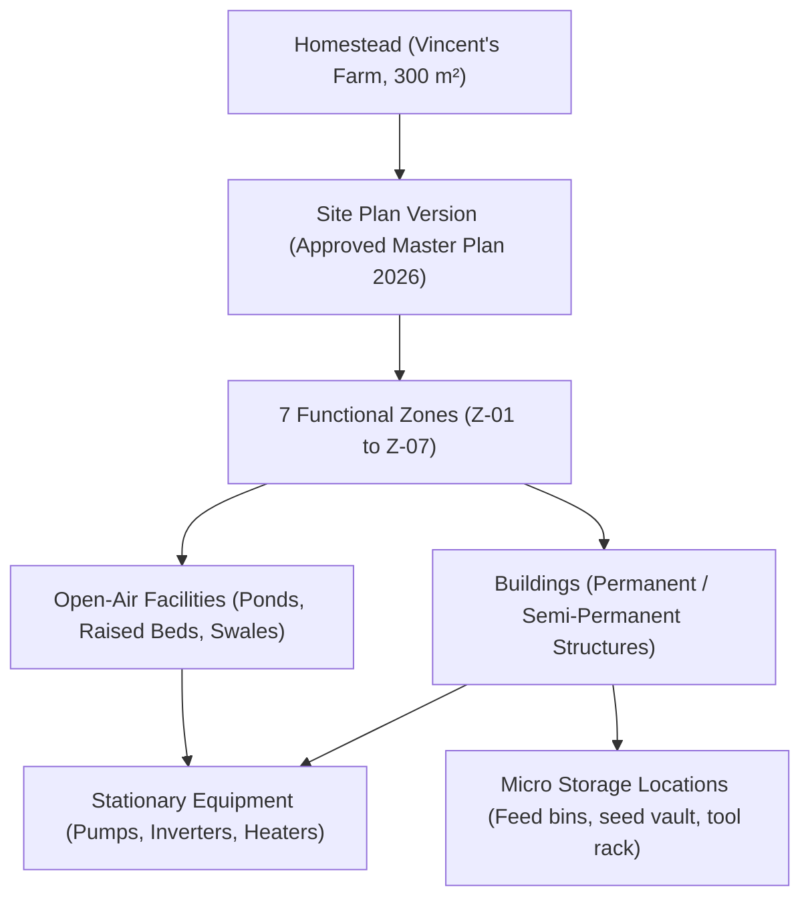

# Canonical Homestead Spatial Model — Vincent's Farm (300 m²)

> **Physical Site Specification & Spatial Taxonomy**  
> **Location**: West Java, Indonesia (Tropical Highland Monsoon, -6.9175° S, 107.6191° E)  
> **Master Dimensions**: 15.0 meters wide × 20.0 meters deep = **300.0 m²**  
> **Document Version**: 1.0.0 | **Status**: Verified Master Plan Specification

---

## 1. Spatial Hierarchy Principle

> [!IMPORTANT]
> **Core Architectural Rule**: Zones are continuous geographic sectors, **NOT** individual buildings. A single Zone contains physical buildings, open-air facilities, stationary equipment, and micro storage locations.



---

## 2. Master Plan Spatial Layout & Coordination

The 300 m² property is oriented along a North-South axis to maximize solar capture and prevailing highland breeze:

```
+=============================================================================+
|                      NORTH BOUNDARY — 15.0 METERS                           |
+--------------------------------------+--------------------------------------+
| ZONE 1: SMART MICRO-GREENHOUSE       | ZONE 2: AQUAPONICS & BIO-POND        |
| Sector Area: 35.0 m² (5.0m x 7.0m)   | Sector Area: 25.0 m² (5.0m x 5.0m)   |
| Buildings: Greenhouse Polycarbonate  | Open Facility: 12 m³ Tilapia Bio-Tank|
| Facilities: Vertical NFT lines (4x)  | Open Facility: 6 m³ Catfish Sump     |
| Equipment: Ultrasonic misting, fans  | Equipment: Kaldnes K1 Bio-Filter     |
+--------------------------------------+--------------------------------------+
| ZONE 3: INTENSIVE POULTRY & BSF HUB  | ZONE 5: SOLAR ARRAY & BATTERY HUB    |
| Sector Area: 20.0 m² (4.0m x 5.0m)   | Sector Area: 30.0 m² (6.0m x 5.0m)   |
| Buildings: Deep-Litter Poultry Shed  | Buildings: Insulated Inverter Shed   |
| Facilities: Mobile pasture tractor   | Facilities: 5.2 kWp Bifacial Canopy  |
| Equipment: 5-tray stacked BSF unit   | Equipment: Growatt 8kW + 15.3kWh BMS |
+--------------------------------------+--------------------------------------+
| ZONE 4: PERMACULTURE FOOD FOREST & RAISED BEDS                              |
| Sector Area: 110.0 m² (11.0m x 10.0m)                                       |
| Facilities: 6x Keyhole raised beds (living soil + biochar)                  |
| Facilities: 8x California Dwarf Papaya perennial guilds                     |
| Facilities: 4x Dwarf Cavendish banana circles & bio-swales                  |
| Facilities: 3-bay active Bokashi composting station                         |
+--------------------------------------+--------------------------------------+
| ZONE 6: WATER CATCHMENT & FILTRATION | ZONE 7: ECO-LIVING QUARTERS & SEED   |
| Sector Area: 25.0 m² (5.0m x 5.0m)   | Sector Area: 55.0 m² (11.0m x 5.0m)  |
| Facilities: 140 m² roof catchment    | Buildings: Passive Solar Dwelling    |
| Facilities: 3x 4,000 L food-grade    | Storage: 74-variety Heirloom Vault   |
| Equipment: Vortex first-flush filter | Equipment: Central Home OS Terminal  |
| Equipment: Gravity sand/biochar tower| Facilities: Greywater Reed Bed       |
+======================================+======================================+
|                      SOUTH BOUNDARY (Main Access Road)                      |
+=============================================================================+
```

---

## 3. Exhaustive Breakdown of All 7 Zones

### Zone 1: Smart Micro-Greenhouse (`Z-01`)
- **Area**: 35.0 m² ($5.0\text{ m} \times 7.0\text{ m}$)
- **Primary Domain**: `CULTIVATION`
- **Buildings**: 1x Galvanized light-steel framed polycarbonate greenhouse ($4.5\text{ m} \times 6.5\text{ m}$).
- **Facilities**:
  - 4x Multi-tier A-Frame Vertical NFT hydroponic racks (120 plant capacity each).
  - 1x Germination & microgreen propagation bench with heat mats.
  - 1x Light-sealed oyster mushroom fruiting dark chamber ($2.0\text{ m} \times 1.5\text{ m}$).
- **Stationary Equipment**: Automated ultrasonic nutrient misting manifold, inline EC/pH sensors, solar-powered cross-ventilation exhaust fans.
- **Micro Storage**: Seedling germination trays, rockwool cubes, nutrient stock bottles.

### Zone 2: Aquaponics & Bio-Pond (`Z-02`)
- **Area**: 25.0 m² ($5.0\text{ m} \times 5.0\text{ m}$)
- **Primary Domain**: `AQUACULTURE`
- **Open-Air Facilities**:
  - 1x Circular reinforced geomembrane tank ($\varnothing 3.0\text{ m}$, volume $12.0\text{ m³}$) stocked with 450 Nile Tilapia (*Oreochromis niloticus*).
  - 1x Rectangular partitioned deep sump tank ($2.0\text{ m} \times 1.5\text{ m}$, volume $6.0\text{ m³}$) stocked with 120 African Catfish (*Clarias gariepinus*).
  - 2x Shallow duckweed (*Lemna minor*) cultivation nursery troughs ($2.0\text{ m} \times 0.8\text{ m}$).
- **Stationary Equipment**: Moving Bed Biofilm Reactor (MBBR) with 150 L Kaldnes K1 media, Resun LP-100 high-efficiency diaphragm air pump, 80W solids lifting vortex pump.

### Zone 3: Intensive Poultry & BSF Hub (`Z-03`)
- **Area**: 20.0 m² ($4.0\text{ m} \times 5.0\text{ m}$)
- **Primary Domain**: `LIVESTOCK` & `CIRCULAR`
- **Buildings**: 1x Elevated wooden and mesh poultry shed ($3.0\text{ m} \times 3.0\text{ m}$) with deep-litter carbon bedding (sawdust and dry leaves).
- **Facilities**:
  - Roll-out laying nesting boxes (6 boxes).
  - 1x Mobile pastured chicken tractor for rotation in Zone 4 swales.
  - 1x Stacked 5-tray Black Soldier Fly (*Hermetia illucens*) bioconversion breeding rack ($1.5\text{ m} \times 0.8\text{ m}$).
- **Biological Stock**: 24 Ayam KUB (Indonesian native dual-purpose), 30 Joper meat birds, 20 Cornish Cross broilers.

### Zone 4: Permaculture Food Forest & Raised Beds (`Z-04`)
- **Area**: 110.0 m² ($11.0\text{ m} \times 10.0\text{ m}$)
- **Primary Domain**: `CULTIVATION`
- **Facilities**:
  - 6x Keyhole permaculture raised beds ($3.0\text{ m} \times 1.2\text{ m}$ each, amended with 15% biochar and compost).
  - 8x California Dwarf Papaya trees (*Carica papaya*) intercropped with lemongrass guilds.
  - 4x Dwarf Cavendish banana circles linked to domestic greywater infiltration swales.
  - 1x 3-Bay aerobic Bokashi composting station ($3.0\text{ m} \times 1.0\text{ m}$, concrete base with leachate trap).

### Zone 5: Solar Array & Battery Hub (`Z-05`)
- **Area**: 30.0 m² ($6.0\text{ m} \times 5.0\text{ m}$)
- **Primary Domain**: `ENERGY_WATER`
- **Buildings**: 1x Thermally insulated, fire-rated electrical equipment shed ($2.5\text{ m} \times 2.0\text{ m}$).
- **Facilities**: Elevated solar canopy structure mounting 10x 520 Wp bifacial mono-crystalline PV panels (5.2 kWp nominal).
- **Stationary Equipment**: 1x Growatt 8 kW 48V Off-Grid Hybrid Inverter, 1x 15.3 kWh LiFePO4 battery pack (300 Ah, 51.2V) with integrated BMS and RS485 telemetry gateway.

### Zone 6: Water Catchment & Filtration (`Z-06`)
- **Area**: 25.0 m² ($5.0\text{ m} \times 5.0\text{ m}$)
- **Primary Domain**: `ENERGY_WATER`
- **Facilities**:
  - 140 m² effective roof catchment collection guttering across main residence and solar shed.
  - 3x 4,000 L food-grade high-density polyethylene (HDPE) vertical water cisterns (12,000 L total buffer).
- **Stationary Equipment**: Vortex self-cleaning first-flush diverter (diverts first 2 mm of rainfall), 4-stage gravity filtration tower (coarse mesh, graded gravel, silica sand, activated coconut shell biochar).

### Zone 7: Eco-Living Quarters & Nursery (`Z-07`)
- **Area**: 55.0 m² ($11.0\text{ m} \times 5.0\text{ m}$)
- **Primary Domain**: `LIVING` & `STEWARDSHIP`
- **Buildings**: Passive solar homestead dwelling ($8.0\text{ m} \times 5.0\text{ m}$) with shaded verandas.
- **Micro Storage & Systems**:
  - Climate-controlled heirloom seed vault (74 cataloged heritage varieties at 16°C and 40% RH).
  - Central Home OS terminal and local edge server (Intel N100 running NestJS and PostgreSQL).
  - Domestic kitchen preparation station with dedicated organic scrap separation buckets.

---

## 4. Verification Status: Ground Truth vs. Micro-Measurements

| Dimension / Element | Value | Status | Action Required |
| :--- | :--- | :---: | :--- |
| **Total Property Area** | 300.0 m² ($15\text{ m} \times 20\text{ m}$) | **Verified** | Approved Master Plan boundary; non-negotiable baseline. |
| **Zone 1 Area** | 35.0 m² | **Verified** | Built footprint matches CAD layout. |
| **Zone 2 Area** | 25.0 m² | **Verified** | Bio-pond containment walls completed. |
| **Zone 3 Area** | 20.0 m² | **Verified** | Poultry coop and BSF shelter constructed. |
| **Zone 4 Area** | 110.0 m² | **Verified** | Food forest perimeter staked and swaled. |
| **Zone 5 Area** | 30.0 m² | **Verified** | Solar canopy footings installed. |
| **Zone 6 Area** | 25.0 m² | **Verified** | Concrete pad for 3x cisterns completed. |
| **Zone 7 Area** | 55.0 m² | **Verified** | Residence foundation dimensions verified. |
| **Total Area Check** | $\sum = 300.0\text{ m²}$ | **Verified** | Exact match. |
| **Z-07 Seed Vault Partition** | $\approx 10\text{ cm}$ | *Unverified* | Verify physical wall insulation thickness on-site. |
| **Z-06 to Z-02 Drain Slope** | $\approx 2.5\%$ grade | *Unverified* | Measure underground PVC elevation with laser level. |
| **Z-04 Shade Trellis Clearance**| $\approx 2.4\text{ m}$ height | *Unverified* | Measure overhead cable clearance from finished soil bed. |
