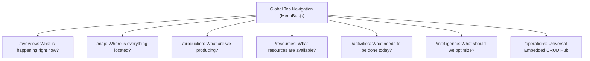
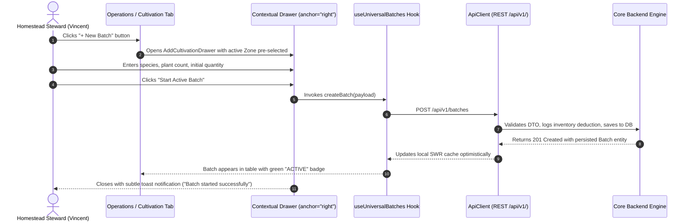

# Console Architecture Blueprint — Terra Interface

> **Frontend Application Specification**  
> **Framework**: Next.js 13 (Pages Router), Material-UI v5, Emotion, TypeScript/JavaScript  
> **Design Language**: Modern Nature-Tech Light (Warm White, Soft Cream, Forest Green, Emerald, Lime)  
> **Document Version**: 1.0.0 | **Status**: Architecture Specification

---

## 1. Design System & Aesthetics

Terra Interface rejects conventional grey enterprise ERP layouts in favor of an organic, calm, and visual-first **Modern Nature-Tech Light** aesthetic tailored for personal homestead operations:

- **Primary Colors**: Forest Green (`#1B4332`), Emerald Green (`#10B981`), Lime Accent (`#84CC16`).
- **Surface Colors**: Warm White (`#FAF9F5`), Soft Cream (`#F4F1EA`), Translucent Frosted Glass (`rgba(255, 255, 255, 0.8)`).
- **Typography**: Manrope (`weights: 400, 500, 600, 700, 800`) across all headings, body text, and KPI numerals.
- **Card Styling**: Generous corner radiuses (`borderRadius: 16px` to `24px`), subtle border outlines (`1px solid rgba(27, 67, 50, 0.08)`), and soft natural ambient elevations.
- **Visual Identity**: Miniature isometric 3D architectural illustrations and SVG cross-sections as primary hero components.

---

## 2. Page Responsibilities & UX Principle

Each top-level route in the horizontal navigation answers one specific operational question:



### Detailed Route Mapping

| Route | Main Purpose | Hero Visualization | Key Actions / Interactions |
| :--- | :--- | :--- | :--- |
| **`/overview`** | Real-time ecosystem pulse & health | Isometric Homestead 3D View | Quick-action shortcuts, real-time alert banners, autonomy score ring. |
| **`/map`** | Spatial inspection across 7 zones | Interactive 3D Site Plan | Zone filtering, 3D Site Plan vs Zone List vs Resource Flow toggle, facility hover cards. |
| **`/production`** | Food yield analytics & category totals | Category output breakdown | Multi-harvest logs, yield trend curves, batch completion summaries. |
| **`/resources`** | Microgrid energy & water balances | Isometric circular flow diagram | Battery SoC % monitor, rainwater cistern gauge, pantry stock depletion warnings. |
| **`/activities`** | Daily chores & maintenance schedules | Daily timeline view | Work order completion toggles, recurring task checklists, assigned chore logs. |
| **`/intelligence`** | AI recommendations & autonomy forecasting | Circularity index radar | Accept/dismiss AI recommendations, weather forecast impact simulations. |
| **`/operations`** | Deep management & operational records | Domain-specific tabular grids | Contextual side-drawers for Add Batch, Record Harvest, Stock In/Out, Water Test. |

---

## 3. Directory Layout: Feature-Based Structure

The target frontend structure refactors monolithic pages into encapsulated feature slices under `console/`:

```
console/
├── components/                         # Shared UI primitives across all views
│   ├── isometric/                      # Isometric SVG interactive graphics
│   │   ├── IsometricHomesteadHero.js   # 300 m² Homestead Site Map
│   │   └── IsometricResourceFlow.js    # Multi-loop nutrient & energy circuit
│   ├── layout/
│   │   ├── MainLayout.js               # Global top navigation & shell wrapper
│   │   └── MenuBar.js                  # Horizontal top nav with active pills
│   └── ui/                             # Reusable design tokens & cards
│       ├── StatCard.js                 # Nature-tech KPI summary card
│       ├── MetricProgress.js           # Progress bar with organic styling
│       └── StatusBadge.js              # Universal batch status indicator pill
├── constants/
│   └── navigation.constants.js         # Top navigation links, icons, and routes
├── data/
│   └── operationsData.js               # Baseline seed reference & local defaults
├── features/                           # Domain Feature Modules (Target Architecture)
│   ├── cultivation/
│   │   ├── components/                 # NFT tables, plant catalog grid
│   │   ├── drawers/AddBatchDrawer.js   # Contextual batch creation drawer
│   │   └── drawers/RecordHarvestDrawer.js
│   ├── livestock/
│   │   ├── components/                 # Flock health cards, egg tally tables
│   │   └── drawers/LogEggHarvestDrawer.js
│   ├── aquaculture/
│   │   ├── components/                 # Pond DO/pH gauges, feeding timers
│   │   └── drawers/RecordWaterTestDrawer.js
│   ├── circular/
│   │   ├── components/                 # BSF bioconversion tray monitors, compost bays
│   │   └── drawers/RecordCompostTurnDrawer.js
│   ├── inventory/
│   │   ├── components/                 # Stock movement ledger, SKU catalog
│   │   └── drawers/StockAdjustmentDrawer.js
│   └── microgrid/
│       └── components/                 # Solar generation curves, cistern level indicators
├── hooks/                              # Custom React Hooks
│   ├── useUniversalBatches.js          # SWR batch fetching, caching, and mutation
│   ├── useOperationsCRUD.js            # Contextual drawer state & form validation
│   └── useHomesteadTelemetry.js        # Real-time telemetry feed listener
├── services/                           # API Layer
│   ├── apiClient.js                    # Base HTTP client with error handling
│   ├── batchService.js                 # Universal Batch REST client
│   └── telemetryService.js             # Telemetry endpoints
├── pages/                              # Next.js Pages (Routes)
│   ├── _app.js                         # ThemeProvider & Manrope typography
│   ├── index.js                        # Client redirect to /overview
│   ├── overview.js
│   ├── map.js
│   ├── production.js
│   ├── resources.js
│   ├── activities.js
│   ├── intelligence.js
│   └── operations/
│       └── index.js                    # Mounts feature modules with contextual drawers
└── theme/
    └── theme.js                        # Material-UI Light Nature palette & overrides
```

---

## 4. Embedded CRUD Architecture

Rather than redirecting the homestead steward to a disconnected administrative dashboard, all operational workflows are embedded directly within the active view using **Contextual Side Drawers**:



### UX Principles for Embedded Forms
1. **Preserve Spatial Context**: The underlying map or data table remains visible beneath the frosted glass backdrop of the side drawer.
2. **Pre-filled Contextual Defaults**: If opened from Zone 1 on the map, the zone selector automatically defaults to `Z-01: Smart Micro-Greenhouse`.
3. **Immediate Optimistic Feedback**: Tables update instantly upon submission; if the backend responds with a network or validation error, the UI rolls back gracefully and displays an inline alert.
4. **Keyboard Friendly**: `Escape` closes active drawers; `Ctrl + Enter` submits forms.
