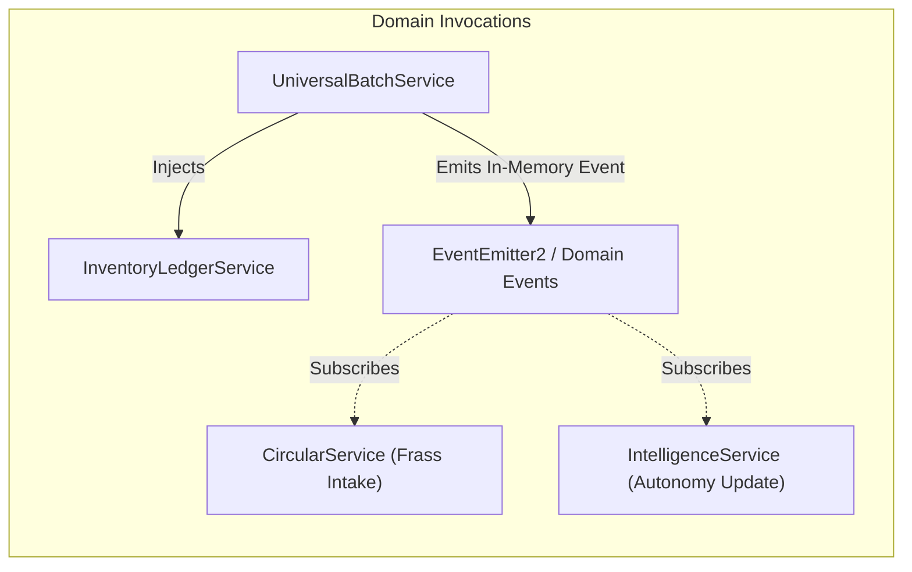

# Core Architecture Blueprint — Terra Interface

> **Backend Application Specification**  
> **Framework**: NestJS (TypeScript), Prisma ORM, PostgreSQL  
> **Pattern**: Domain-Based Modular Monolith  
> **Document Version**: 1.0.0 | **Status**: Architecture Specification

---

## 1. Architectural Philosophy: Domain Modular Monolith

Terra Interface uses a **Domain-Based Modular Monolith** rather than distributed microservices. For a 300 m² homestead edge system, a modular monolith provides:
- **Zero Network Overhead**: In-process method calls between domains eliminate serialization latencies and distributed transaction complexities.
- **Strict Domain Boundaries**: Each operational area (Cultivation, Livestock, Aquaculture, Circular, Inventory, Microgrid) is encapsulated in its own NestJS module with explicit public service contracts.
- **Single Source of Truth**: All domain services transact against a single PostgreSQL database via Prisma ORM, enabling ACID transactions during batch status changes and inventory balance deductions.
- **Lightweight Edge Footprint**: Easily hosted on an edge computer (Raspberry Pi 5, Intel N100 mini PC) consuming under 512 MB RAM while serving real-time telemetry.

---

## 2. Target Directory & Module Structure

```
core/
├── prisma/
│   ├── schema.prisma                  # Master normalized PostgreSQL schema
│   └── seeders/                       # Idempotent seeders for homestead initialization
│       ├── zones.seeder.ts            # 7 Canonical zones for Vincent's Farm (300 m²)
│       ├── production-types.seeder.ts # Dynamic product taxonomy
│       ├── storage-locations.seeder.ts# Homestead storage bins, pantry, sheds
│       ├── batches.seeder.ts          # Initial active batches & harvest logs
│       └── seed.ts                    # Master execution runner
├── src/
│   ├── app.module.ts                  # Root module importing all domain modules
│   ├── main.ts                        # Bootstrap, Swagger, ValidationPipe, CORS
│   ├── constants/
│   │   └── homestead.constants.ts     # Master homestead dimensions, alert thresholds
│   ├── helpers/
│   │   └── ecological-calculator.helper.ts # FCR, Solar Autonomy, Water Storage formulas
│   ├── common/                        # Cross-cutting utilities
│   │   ├── filters/http-exception.filter.ts # Standardized error envelope
│   │   ├── interceptors/transform.interceptor.ts # Standardized success envelope
│   │   └── decorators/roles.decorator.ts
│   ├── prisma/
│   │   └── prisma.service.ts          # Managed Prisma Client lifecycle
│   └── modules/                       # Domain Modules
│       ├── universal-batch/           # [IMPLEMENTED] Core Batch Engine & State Machine
│       │   ├── dto/
│       │   │   ├── create-batch.dto.ts
│       │   │   ├── transition-status.dto.ts
│       │   │   ├── record-output.dto.ts
│       │   │   └── batch-response.dto.ts
│       │   ├── universal-batch.controller.ts
│       │   ├── universal-batch.service.ts
│       │   └── universal-batch.module.ts
│       ├── cultivation/               # [TARGET] Hydroponics, NFT, Raised Beds
│       │   ├── cultivation.controller.ts
│       │   ├── cultivation.service.ts
│       │   └── cultivation.module.ts
│       ├── livestock/                 # [TARGET] Chickens (KUB, Joper), Ruminants
│       │   ├── livestock.controller.ts
│       │   ├── livestock.service.ts
│       │   └── livestock.module.ts
│       ├── aquaculture/               # [TARGET] Tilapia & Catfish Bio-Ponds
│       │   ├── aquaculture.controller.ts
│       │   ├── aquaculture.service.ts
│       │   └── aquaculture.module.ts
│       ├── circular/                  # [TARGET] BSF Bioconversion & Bokashi Compost
│       │   ├── circular.controller.ts
│       │   ├── circular.service.ts
│       │   └── circular.module.ts
│       ├── inventory/                 # [TARGET] Immutable Stock Movement Ledger
│       │   ├── inventory.controller.ts
│       │   ├── inventory.service.ts
│       │   └── inventory.module.ts
│       ├── microgrid/                 # [TARGET] Solar PV, Battery BMS, Cistern Telemetry
│       │   ├── microgrid.controller.ts
│       │   ├── microgrid.service.ts
│       │   └── microgrid.module.ts
│       └── intelligence/              # [TARGET] Autonomy scoring & AI recommendations
│           ├── intelligence.controller.ts
│           ├── intelligence.service.ts
│           └── intelligence.module.ts
```

---

## 3. Layered Pattern Within Each Domain

Every domain module enforces a 4-tier separation of concerns:

```mermaid
graph TD
    Client["Console Frontend / IoT Device"] -->|HTTP Request / JSON| Controller["NestJS Controller (Swagger @ApiTags, Route handlers)"]
    Controller -->|Validated DTO (class-validator)| Service["Domain Service (Business Logic, State Invariants)"]
    Service -->|ACID DB Transactions| Prisma["Prisma ORM (Data Access Layer)"]
    Prisma --> PostgreSQL[("PostgreSQL Database")]
```

1. **Controller Layer**: Handles HTTP requests, extracts parameters, applies Swagger decorators, and validates inbound payloads using `ValidationPipe({ whitelist: true, transform: true })`.
2. **Service Layer**: Houses domain rules, executes lifecycle transitions, checks physical constraints (e.g. pond stocking density limits, battery minimum state-of-charge), and orchestrates multi-model transactions.
3. **Data Access Layer**: Direct interface with Prisma Client, strictly encapsulated within services. Controllers never invoke Prisma queries directly.
4. **Data Transfer Objects (DTOs)**: Strongly typed TypeScript classes decorated with `class-validator` and `@nestjs/swagger` annotations.

---

## 4. Cross-Domain Communication Rules

To prevent spaghetti dependencies across domain modules:



- **Direct Service Injection**: Used when an operation requires an immediate, atomic database transaction (e.g., creating a batch immediately deducts seed stock via `InventoryLedgerService.createMovement`).
- **Domain Event Bus (`@nestjs/event-emitter`)**: Used for decoupled side effects where eventual consistency is acceptable (e.g., notifying the Intelligence service of an egg harvest to update the self-sufficiency index).
- **Prohibited**: Direct imports of another module's Prisma models or raw SQL queries across domain boundaries.
