# Database schema reference

This reference is derived from core/prisma/schema.prisma via the generated Prisma Client metadata. Regenerate the client after schema changes before updating this reference. It describes models and explicit foreign-key relations, not verified deployed migrations.

Current schema: 37 models. PostgreSQL is the configured provider.

## Relationships

```mermaid
erDiagram
    Homestead {
        String id
    }
    SitePlanVersion {
        String id
    }
    Zone {
        String id
    }
    Building {
        String id
    }
    Facility {
        String id
    }
    Equipment {
        String id
    }
    ProductCategory {
        String id
    }
    ProductDefinition {
        String id
    }
    MeasurementUnit {
        String id
    }
    UnitConversion {
        String id
    }
    CustomFieldDefinition {
        String id
    }
    CustomFieldValue {
        String id
    }
    ProductionType {
        String id
    }
    CustomField {
        String id
    }
    BatchCustomFieldValue {
        String id
    }
    Batch {
        String id
    }
    BatchStatusHistory {
        String id
    }
    BatchEvent {
        String id
    }
    BatchOutput {
        String id
    }
    BatchHistory {
        String id
    }
    CultivationBatchDetail {
        String id
    }
    LivestockBatchDetail {
        String id
    }
    AquacultureBatchDetail {
        String id
    }
    BsfBatchDetail {
        String id
    }
    CompostBatchDetail {
        String id
    }
    GrowingRecord {
        String id
    }
    StorageLocation {
        String id
    }
    InventoryItem {
        String id
    }
    StockMovement {
        String id
    }
    StockTx {
        String id
    }
    EnergyNode {
        String id
    }
    WaterNode {
        String id
    }
    ResourceFlowLog {
        String id
    }
    WorkOrder {
        String id
    }
    SensorDevice {
        String id
    }
    TelemetryReading {
        String id
    }
    AiRecommendation {
        String id
    }
    Homestead ||--o{ SitePlanVersion : homestead
    Homestead ||--o{ Zone : homestead
    Zone ||--o{ Building : zone
    Zone ||--o{ Facility : zone
    Building |o--o{ Facility : building
    Facility ||--o{ Equipment : facility
    Homestead ||--o{ ProductCategory : homestead
    ProductCategory ||--o{ ProductDefinition : category
    MeasurementUnit |o--o{ ProductDefinition : defaultUnit
    MeasurementUnit ||--o{ UnitConversion : sourceUnit
    MeasurementUnit ||--o{ UnitConversion : targetUnit
    ProductDefinition ||--o{ CustomFieldDefinition : productDefinition
    CustomFieldDefinition ||--o{ CustomFieldValue : fieldDef
    Batch ||--o{ CustomFieldValue : batch
    Homestead ||--o{ ProductionType : homestead
    ProductionType ||--o{ CustomField : productionType
    Batch ||--o{ BatchCustomFieldValue : batch
    CustomField ||--o{ BatchCustomFieldValue : customField
    ProductionType |o--o{ Batch : productionType
    ProductDefinition |o--o{ Batch : productDefinition
    Zone ||--o{ Batch : zone
    Batch ||--o{ BatchStatusHistory : batch
    Batch ||--o{ BatchEvent : batch
    Batch ||--o{ BatchOutput : batch
    Batch ||--o{ BatchHistory : batch
    Batch ||--o| CultivationBatchDetail : batch
    Batch ||--o| LivestockBatchDetail : batch
    Batch ||--o| AquacultureBatchDetail : batch
    Batch ||--o| BsfBatchDetail : batch
    Batch ||--o| CompostBatchDetail : batch
    Batch ||--o{ GrowingRecord : batch
    Homestead ||--o{ StorageLocation : homestead
    Homestead ||--o{ InventoryItem : homestead
    StorageLocation ||--o{ InventoryItem : location
    ProductDefinition |o--o{ InventoryItem : productDef
    InventoryItem ||--o{ StockMovement : item
    BatchOutput |o--o| StockMovement : batchOutput
    InventoryItem ||--o{ StockTx : item
    Zone ||--o{ SensorDevice : zone
    Zone ||--o{ TelemetryReading : zone
    SensorDevice |o--o{ TelemetryReading : sensor
```

## Model fields

Nullable fields use ?, lists use []. Relation fields identify the linked model; foreign-key scalar fields are listed separately. Defaults, indexes and delete actions remain authoritative in schema.prisma.

### Homestead

| Field | Type | Notes |
| --- | --- | --- |
| id | String | Primary key; Default defined |
| name | String | Default defined |
| totalAreaSqm | Float | Default defined |
| dimensions | String | Default defined |
| location | String | Default defined |
| climateType | String | Default defined |
| latitude | Float | Default defined |
| longitude | Float | Default defined |
| stewardName | String | Default defined |
| sitePlanVersions | SitePlanVersion[] | Relation |
| zones | Zone[] | Relation |
| productionTypes | ProductionType[] | Relation |
| productCategories | ProductCategory[] | Relation |
| inventoryItems | InventoryItem[] | Relation |
| storageLocations | StorageLocation[] | Relation |
| createdAt | DateTime | Default defined |
| updatedAt | DateTime |  |

### SitePlanVersion

| Field | Type | Notes |
| --- | --- | --- |
| id | String | Primary key; Default defined |
| homesteadId | String |  |
| homestead | Homestead | Relation; Foreign key: homesteadId |
| versionName | String |  |
| isCurrent | Boolean | Default defined |
| svgLayout | String? |  |
| createdAt | DateTime | Default defined |

### Zone

| Field | Type | Notes |
| --- | --- | --- |
| id | String | Primary key; Default defined |
| code | String | Unique |
| name | String |  |
| homesteadId | String |  |
| homestead | Homestead | Relation; Foreign key: homesteadId |
| areaSqm | Float |  |
| type | String |  |
| domainTag | String? | Default defined |
| colorHex | String | Default defined |
| buildings | Building[] | Relation |
| facilities | Facility[] | Relation |
| batches | Batch[] | Relation |
| sensorDevices | SensorDevice[] | Relation |
| telemetryLogs | TelemetryReading[] | Relation |
| createdAt | DateTime | Default defined |
| updatedAt | DateTime |  |

### Building

| Field | Type | Notes |
| --- | --- | --- |
| id | String | Primary key; Default defined |
| zoneId | String |  |
| zone | Zone | Relation; Foreign key: zoneId |
| name | String |  |
| footprintSqm | Float |  |
| roofAreaSqm | Float | Default defined |
| facilities | Facility[] | Relation |
| createdAt | DateTime | Default defined |

### Facility

| Field | Type | Notes |
| --- | --- | --- |
| id | String | Primary key; Default defined |
| zoneId | String |  |
| zone | Zone | Relation; Foreign key: zoneId |
| buildingId | String? |  |
| building | Building? | Relation; Foreign key: buildingId |
| name | String |  |
| type | String |  |
| equipment | Equipment[] | Relation |
| createdAt | DateTime | Default defined |

### Equipment

| Field | Type | Notes |
| --- | --- | --- |
| id | String | Primary key; Default defined |
| facilityId | String |  |
| facility | Facility | Relation; Foreign key: facilityId |
| name | String |  |
| modelNumber | String? |  |
| ratedPowerWatt | Float | Default defined |
| status | String | Default defined |
| createdAt | DateTime | Default defined |

### ProductCategory

| Field | Type | Notes |
| --- | --- | --- |
| id | String | Primary key; Default defined |
| homesteadId | String |  |
| homestead | Homestead | Relation; Foreign key: homesteadId |
| name | String |  |
| domain | String |  |
| icon | String? | Default defined |
| products | ProductDefinition[] | Relation |
| createdAt | DateTime | Default defined |

### ProductDefinition

| Field | Type | Notes |
| --- | --- | --- |
| id | String | Primary key; Default defined |
| categoryId | String |  |
| category | ProductCategory | Relation; Foreign key: categoryId |
| name | String |  |
| sku | String | Unique |
| defaultUnitId | String? |  |
| defaultUnit | MeasurementUnit? | Relation; Foreign key: defaultUnitId |
| densityKgPerL | Float? |  |
| customFields | CustomFieldDefinition[] | Relation |
| batches | Batch[] | Relation |
| inventoryItems | InventoryItem[] | Relation |
| createdAt | DateTime | Default defined |

### MeasurementUnit

| Field | Type | Notes |
| --- | --- | --- |
| id | String | Primary key; Default defined |
| symbol | String | Unique |
| name | String |  |
| dimension | String |  |
| products | ProductDefinition[] | Relation |
| sourceConvs | UnitConversion[] | Relation |
| targetConvs | UnitConversion[] | Relation |

### UnitConversion

| Field | Type | Notes |
| --- | --- | --- |
| id | String | Primary key; Default defined |
| sourceUnitId | String |  |
| sourceUnit | MeasurementUnit | Relation; Foreign key: sourceUnitId |
| targetUnitId | String |  |
| targetUnit | MeasurementUnit | Relation; Foreign key: targetUnitId |
| multiplier | Float |  |

### CustomFieldDefinition

| Field | Type | Notes |
| --- | --- | --- |
| id | String | Primary key; Default defined |
| productDefinitionId | String |  |
| productDefinition | ProductDefinition | Relation; Foreign key: productDefinitionId |
| key | String |  |
| label | String |  |
| dataType | String |  |
| isRequired | Boolean | Default defined |
| values | CustomFieldValue[] | Relation |

### CustomFieldValue

| Field | Type | Notes |
| --- | --- | --- |
| id | String | Primary key; Default defined |
| fieldDefId | String |  |
| fieldDef | CustomFieldDefinition | Relation; Foreign key: fieldDefId |
| batchId | String |  |
| batch | Batch | Relation; Foreign key: batchId |
| value | String |  |

### ProductionType

| Field | Type | Notes |
| --- | --- | --- |
| id | String | Primary key; Default defined |
| homesteadId | String |  |
| homestead | Homestead | Relation; Foreign key: homesteadId |
| domain | String |  |
| name | String |  |
| defaultUnit | String | Default defined |
| customFields | CustomField[] | Relation |
| batches | Batch[] | Relation |
| createdAt | DateTime | Default defined |
| updatedAt | DateTime |  |

### CustomField

| Field | Type | Notes |
| --- | --- | --- |
| id | String | Primary key; Default defined |
| productionTypeId | String |  |
| productionType | ProductionType | Relation; Foreign key: productionTypeId |
| fieldName | String |  |
| fieldType | String |  |
| isRequired | Boolean | Default defined |
| values | BatchCustomFieldValue[] | Relation |

### BatchCustomFieldValue

| Field | Type | Notes |
| --- | --- | --- |
| id | String | Primary key; Default defined |
| batchId | String |  |
| batch | Batch | Relation; Foreign key: batchId |
| customFieldId | String |  |
| customField | CustomField | Relation; Foreign key: customFieldId |
| value | String |  |

### Batch

| Field | Type | Notes |
| --- | --- | --- |
| id | String | Primary key; Default defined |
| batchCode | String | Unique |
| name | String |  |
| domain | String |  |
| productionTypeId | String? |  |
| productionType | ProductionType? | Relation; Foreign key: productionTypeId |
| productDefinitionId | String? |  |
| productDefinition | ProductDefinition? | Relation; Foreign key: productDefinitionId |
| zoneId | String |  |
| zone | Zone | Relation; Foreign key: zoneId |
| status | BatchStatus | Default defined |
| startDate | DateTime |  |
| expectedEndDate | DateTime? |  |
| actualEndDate | DateTime? |  |
| initialQuantity | Float | Default defined |
| currentQuantity | Float | Default defined |
| measurementUnit | String |  |
| healthIndex | Float? | Default defined |
| notes | String? |  |
| cultivationDetail | CultivationBatchDetail? | Relation |
| livestockDetail | LivestockBatchDetail? | Relation |
| aquacultureDetail | AquacultureBatchDetail? | Relation |
| bsfDetail | BsfBatchDetail? | Relation |
| compostDetail | CompostBatchDetail? | Relation |
| outputs | BatchOutput[] | Relation |
| records | GrowingRecord[] | Relation |
| auditLogs | BatchHistory[] | Relation |
| statusHistory | BatchStatusHistory[] | Relation |
| events | BatchEvent[] | Relation |
| customValues | BatchCustomFieldValue[] | Relation |
| dynamicFieldValues | CustomFieldValue[] | Relation |
| createdAt | DateTime | Default defined |
| updatedAt | DateTime |  |

### BatchStatusHistory

| Field | Type | Notes |
| --- | --- | --- |
| id | String | Primary key; Default defined |
| batchId | String |  |
| batch | Batch | Relation; Foreign key: batchId |
| fromStatus | BatchStatus |  |
| toStatus | BatchStatus |  |
| reason | String? |  |
| changedBy | String | Default defined |
| timestamp | DateTime | Default defined |

### BatchEvent

| Field | Type | Notes |
| --- | --- | --- |
| id | String | Primary key; Default defined |
| batchId | String |  |
| batch | Batch | Relation; Foreign key: batchId |
| eventType | String |  |
| data | Json |  |
| recordedBy | String | Default defined |
| timestamp | DateTime | Default defined |

### BatchOutput

| Field | Type | Notes |
| --- | --- | --- |
| id | String | Primary key; Default defined |
| batchId | String |  |
| batch | Batch | Relation; Foreign key: batchId |
| harvestDate | DateTime | Default defined |
| productName | String |  |
| quantity | Float |  |
| measurementUnit | String |  |
| qualityGrade | String? | Default defined |
| destination | String? |  |
| stewardName | String | Default defined |
| notes | String? |  |
| stockMovement | StockMovement? | Relation |
| createdAt | DateTime | Default defined |

### BatchHistory

| Field | Type | Notes |
| --- | --- | --- |
| id | String | Primary key; Default defined |
| batchId | String |  |
| batch | Batch | Relation; Foreign key: batchId |
| action | String |  |
| details | String? |  |
| performedBy | String | Default defined |
| timestamp | DateTime | Default defined |

### CultivationBatchDetail

| Field | Type | Notes |
| --- | --- | --- |
| id | String | Primary key; Default defined |
| batchId | String | Unique |
| batch | Batch | Relation; Foreign key: batchId |
| growingMedium | String |  |
| lightingType | String? | Default defined |
| ecTarget | Float? |  |
| phTarget | Float? |  |
| trayCount | Int? |  |
| bedNumber | String? |  |

### LivestockBatchDetail

| Field | Type | Notes |
| --- | --- | --- |
| id | String | Primary key; Default defined |
| batchId | String | Unique |
| batch | Batch | Relation; Foreign key: batchId |
| breed | String |  |
| housingSystem | String |  |
| mortalityCount | Int | Default defined |
| targetFcr | Float? |  |

### AquacultureBatchDetail

| Field | Type | Notes |
| --- | --- | --- |
| id | String | Primary key; Default defined |
| batchId | String | Unique |
| batch | Batch | Relation; Foreign key: batchId |
| species | String |  |
| pondVolumeM3 | Float | Default defined |
| targetDensityKgM3 | Float | Default defined |
| aerationType | String? | Default defined |
| dissolvedOxygenMin | Float | Default defined |

### BsfBatchDetail

| Field | Type | Notes |
| --- | --- | --- |
| id | String | Primary key; Default defined |
| batchId | String | Unique |
| batch | Batch | Relation; Foreign key: batchId |
| substrateType | String |  |
| substrateWeightKg | Float |  |
| trayCount | Int | Default defined |
| frassYieldKg | Float? |  |
| maggotYieldKg | Float? |  |

### CompostBatchDetail

| Field | Type | Notes |
| --- | --- | --- |
| id | String | Primary key; Default defined |
| batchId | String | Unique |
| batch | Batch | Relation; Foreign key: batchId |
| bayNumber | String |  |
| carbonNitrogenRatio | Float | Default defined |
| biocharPercent | Float | Default defined |
| turnCount | Int | Default defined |
| peakTempC | Float? |  |
| curedMaturityScore | Float? |  |

### GrowingRecord

| Field | Type | Notes |
| --- | --- | --- |
| id | String | Primary key; Default defined |
| batchId | String |  |
| batch | Batch | Relation; Foreign key: batchId |
| recordDate | DateTime | Default defined |
| recordType | String |  |
| parameter1 | String? |  |
| parameter2 | String? |  |
| notes | String? |  |
| stewardName | String | Default defined |

### StorageLocation

| Field | Type | Notes |
| --- | --- | --- |
| id | String | Primary key; Default defined |
| homesteadId | String |  |
| homestead | Homestead | Relation; Foreign key: homesteadId |
| name | String |  |
| type | String |  |
| capacityInfo | String? |  |
| items | InventoryItem[] | Relation |

### InventoryItem

| Field | Type | Notes |
| --- | --- | --- |
| id | String | Primary key; Default defined |
| homesteadId | String |  |
| homestead | Homestead | Relation; Foreign key: homesteadId |
| sku | String | Unique |
| name | String |  |
| category | String |  |
| locationId | String |  |
| location | StorageLocation | Relation; Foreign key: locationId |
| productDefId | String? |  |
| productDef | ProductDefinition? | Relation; Foreign key: productDefId |
| inStock | Float | Default defined |
| unit | String |  |
| minThreshold | Float | Default defined |
| transactions | StockTx[] | Relation |
| movements | StockMovement[] | Relation |
| createdAt | DateTime | Default defined |
| updatedAt | DateTime |  |

### StockMovement

| Field | Type | Notes |
| --- | --- | --- |
| id | String | Primary key; Default defined |
| itemId | String |  |
| item | InventoryItem | Relation; Foreign key: itemId |
| type | StockMovementType |  |
| quantityDelta | Float |  |
| unit | String |  |
| referenceBatchCode | String? |  |
| batchOutputId | String? | Unique |
| batchOutput | BatchOutput? | Relation; Foreign key: batchOutputId |
| stewardName | String | Default defined |
| notes | String? |  |
| timestamp | DateTime | Default defined |

### StockTx

| Field | Type | Notes |
| --- | --- | --- |
| id | String | Primary key; Default defined |
| itemId | String |  |
| item | InventoryItem | Relation; Foreign key: itemId |
| type | String |  |
| quantity | Float |  |
| reason | String? |  |
| stewardName | String | Default defined |
| timestamp | DateTime | Default defined |

### EnergyNode

| Field | Type | Notes |
| --- | --- | --- |
| id | String | Primary key; Default defined |
| solarKw | Float | Default defined |
| batterySocPct | Float | Default defined |
| inverterPowerWatt | Float | Default defined |
| gridDrawWatt | Float | Default defined |
| updatedAt | DateTime |  |

### WaterNode

| Field | Type | Notes |
| --- | --- | --- |
| id | String | Primary key; Default defined |
| cisternLevelPct | Float | Default defined |
| currentVolumeL | Float | Default defined |
| totalCapacityL | Float | Default defined |
| dailyUsageL | Float | Default defined |
| updatedAt | DateTime |  |

### ResourceFlowLog

| Field | Type | Notes |
| --- | --- | --- |
| id | String | Primary key; Default defined |
| sourceZoneId | String |  |
| destinationZoneId | String |  |
| resourceType | String |  |
| plannedQuantity | Float |  |
| actualQuantity | Float |  |
| measurementUnit | String |  |
| circularityScore | Float | Default defined |
| stewardName | String | Default defined |
| timestamp | DateTime | Default defined |

### WorkOrder

| Field | Type | Notes |
| --- | --- | --- |
| id | String | Primary key; Default defined |
| title | String |  |
| domain | String |  |
| priority | String | Default defined |
| status | String | Default defined |
| assignedTo | String | Default defined |
| dueDate | DateTime |  |
| completedAt | DateTime? |  |
| createdAt | DateTime | Default defined |

### SensorDevice

| Field | Type | Notes |
| --- | --- | --- |
| id | String | Primary key; Default defined |
| zoneId | String |  |
| zone | Zone | Relation; Foreign key: zoneId |
| deviceModel | String |  |
| status | String | Default defined |
| readings | TelemetryReading[] | Relation |
| createdAt | DateTime | Default defined |

### TelemetryReading

| Field | Type | Notes |
| --- | --- | --- |
| id | String | Primary key; Default defined |
| zoneId | String |  |
| zone | Zone | Relation; Foreign key: zoneId |
| sensorId | String? |  |
| sensor | SensorDevice? | Relation; Foreign key: sensorId |
| metric | String |  |
| value | Float |  |
| unit | String |  |
| timestamp | DateTime | Default defined |

### AiRecommendation

| Field | Type | Notes |
| --- | --- | --- |
| id | String | Primary key; Default defined |
| category | String |  |
| severity | String |  |
| title | String |  |
| actionText | String |  |
| isApplied | Boolean | Default defined |
| createdAt | DateTime | Default defined |

## Seed data

All models have explicit demo fixtures. See [database and seeding](../core/docs/database-and-seeding.md). A model existing in the schema does not imply its full CRUD API or durable domain workflow is implemented.
