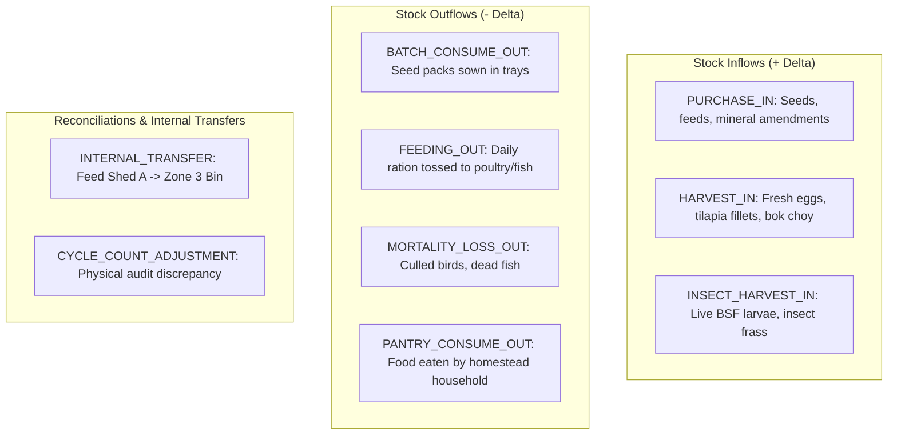

# Inventory Transaction Ledger Specification — Terra Interface

> **Stock Accounting & Materials Management**  
> **Backend Service**: `InventoryLedgerService` (`core/src/modules/inventory/`)  
> **Document Version**: 1.0.0 | **Status**: Architecture Specification

---

## 1. Accounting Philosophy: Immutable Double-Entry Ledger

Traditional farm spreadsheets suffer from race conditions, unexplained stock discrepancies, and untraceable modifications when users directly edit a single `inStock` number.

Terra Interface eliminates this risk by modeling inventory using an **Immutable Transaction Ledger**:
- **Stock balances are never directly updated**.
- The current available quantity of any item is a mathematically derived view computed by summing signed quantity deltas over time.
- Every inventory modification must record a **Movement Type**, a **Reason**, and a **Steward Signature**.

$$\text{CurrentStock}(\text{item}_i, t) = \sum_{k=1}^{N} \text{quantityDelta}_k$$

---

## 2. Stock Movement Taxonomy



### Movement Type Definitions

| Movement Type | Delta Sign | Trigger Event / Description |
| :--- | :---: | :--- |
| `PURCHASE_IN` | **$+$** | Outside goods received from supplier (organic starter mash, rockwool). |
| `HARVEST_IN` | **$+$** | Automated entry generated when a `BatchOutput` is logged. |
| `BATCH_CONSUME_OUT` | **$-$** | Automated entry generated when a batch transitions to `ACTIVE`. |
| `FEEDING_OUT` | **$-$** | Feed ration dispensed during scheduled livestock/fish feeding. |
| `MORTALITY_LOSS_OUT`| **$-$** | Animal or crop loss recorded during health checks. |
| `PANTRY_CONSUME_OUT`| **$-$** | Homestead domestic kitchen consumption. |
| `INTERNAL_TRANSFER` | **$0$ (Net)** | Debits source storage location; credits destination storage location. |
| `CYCLE_COUNT_ADJUSTMENT` | **$+ / -$**| Steward physical stock audit reconciliation. |

---

## 3. Relational Ledger Schema

```prisma
model StorageLocation {
  id           String          @id @default(uuid())
  homesteadId  String
  name         String          // e.g., "Feed & Tool Shed A", "Cold Cellar"
  type         String          // DRY_STORAGE, REFRIGERATED, SEED_VAULT, OUTDOOR_BAY
  items        InventoryItem[]
}

model InventoryItem {
  id                String            @id @default(uuid())
  storageLocationId String
  storageLocation   StorageLocation   @relation(fields: [storageLocationId], references: [id])
  productDefId      String
  productDef        ProductDefinition @relation(fields: [productDefId], references: [id])
  lotNumber         String?           // Seed batch lot or feed production date
  expiryDate        DateTime?
  reorderLevel      Float             @default(5.0)
  movements         StockMovement[]
  createdAt         DateTime          @default(now())

  @@index([storageLocationId, productDefId])
}

model StockMovement {
  id                 String            @id @default(uuid())
  itemId             String
  item               InventoryItem     @relation(fields: [itemId], references: [id], onDelete: Cascade)
  type               StockMovementType
  quantityDelta      Float             // Positive for inflows, negative for outflows
  unit               String
  referenceBatchCode String?           // Foreign batch association if automated
  stewardName        String            @default("Vincent")
  notes              String?
  timestamp          DateTime          @default(now())

  @@index([itemId, timestamp])
}
```

---

## 4. Automated Batch Integration

The inventory ledger is tightly integrated into the Universal Batch lifecycle:

1. **Batch Activation**:
   When a user clicks "Start Batch" for 120 heads of Bok Choy in Zone 1:
   - System checks if $\ge 120$ seeds exist in `InventoryItem(SKU-SEED-BOK)`.
   - If yes, writes `StockMovement(type=BATCH_CONSUME_OUT, quantityDelta=-120)`.
   - If no, the transition is rejected with `400 Insufficient Stock`.

2. **Harvest Intake**:
   When a user logs a 14.5 kg cut of Bok Choy:
   - System writes `BatchOutput(qty=14.5, unit=kg)`.
   - Automatically writes `StockMovement(type=HARVEST_IN, quantityDelta=+14.5, location="Homestead Cold Cellar")`.

3. **Feed Dispensing**:
   When a user logs a 2.5 kg duckweed and BSF feeding in Zone 2:
   - System writes `StockMovement(type=FEEDING_OUT, quantityDelta=-2.5, location="Duckweed Basin 1")`.

---

## 5. Stock Level Auditing & Safety Thresholds

The Console UI dynamically queries aggregated inventory balances:

```sql
SELECT 
    i.id,
    p.name AS product_name,
    l.name AS location_name,
    COALESCE(SUM(m."quantityDelta"), 0) AS in_stock_balance,
    i."reorderLevel"
FROM "InventoryItem" i
JOIN "ProductDefinition" p ON i."productDefId" = p.id
JOIN "StorageLocation" l ON i."storageLocationId" = l.id
LEFT JOIN "StockMovement" m ON i.id = m."itemId"
GROUP BY i.id, p.name, l.name, i."reorderLevel";
```

If `in_stock_balance <= reorderLevel`, the item triggers an immediate **Low Stock Reorder Alert** on the `/overview` and `/resources` views.
