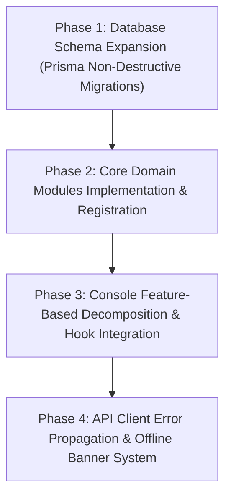

# Migration Plan — Terra Interface

> **Execution Blueprint & Data Migration Protocols**  
> **Document Version**: 1.0.0 | **Status**: Architecture Specification

---

## 1. Migration Strategy Overview

The migration transitions Terra Interface from a prototype with centralized mock fallbacks and a generic Prisma schema to a fully normalized **Domain Modular Monolith** and **Feature-Based Console**.

The plan follows a 4-phase zero-downtime path:



---

## 2. Phase-by-Phase Execution

### Phase 1: Database Schema Expansion (Non-Destructive)
- **Goal**: Expand [core/prisma/schema.prisma](file:///D:/All%20Coding/05%20-%20Applications/Web%20Applications/terra-interface/core/prisma/schema.prisma) to add the normalized 12-domain models without dropping existing `Homestead`, `Zone`, or `Batch` tables.
- **Actions**:
  1. Add 1-to-1 detail models (`CultivationBatchDetail`, `LivestockBatchDetail`, `AquacultureBatchDetail`, `BsfBatchDetail`, `CompostBatchDetail`).
  2. Introduce `StockMovement` table with foreign key to `InventoryItem`.
  3. Execute `npx prisma migrate dev --name init_normalized_domains`.
  4. Run seeder updates to populate default product definitions and initial stock ledgers.
- **Rollback Plan**: Prisma down migration script or restoring PostgreSQL snapshot taken before migration.

### Phase 2: Core Domain Modularization
- **Goal**: Implement dedicated NestJS modules under `core/src/modules/` and mount them in `AppModule`.
- **Actions**:
  1. Scaffold `CultivationModule`, `LivestockModule`, `AquacultureModule`, `CircularModule`, `InventoryModule`, `MicrogridModule`, `IntelligenceModule`.
  2. Implement controllers with Swagger `@ApiTags` and `@ApiOperation` decorators.
  3. Wire domain services to validate business invariants before calling Prisma.
  4. Register all modules into `core/src/app.module.ts`.
  5. Verify that `/api/docs` reflects all 12 domains.
- **Rollback Plan**: Revert `app.module.ts` to only import `UniversalBatchModule`.

### Phase 3: Console Feature-Based Decomposition
- **Goal**: Decompose monolithic 1,191-line [operations/index.js](file:///D:/All%20Coding/05%20-%20Applications/Web%20Applications/terra-interface/console/pages/operations/index.js) into feature folders while preserving the approved Light Nature UI.
- **Actions**:
  1. Move contextual drawers to `console/features/<domain>/drawers/`.
  2. Connect UI tables to [useUniversalBatches.js](file:///D:/All%20Coding/05%20-%20Applications/Web%20Applications/terra-interface/console/hooks/useUniversalBatches.js) and [useOperationsCRUD.js](file:///D:/All%20Coding/05%20-%20Applications/Web%20Applications/terra-interface/console/hooks/useOperationsCRUD.js).
  3. Replace inline mock arrays with SWR queries that fetch from `/api/v1/`.
  4. Verify build succeeds with `npm run build:console`.
- **Rollback Plan**: Git checkout of `operations/index.js` to previous commit.

### Phase 4: API Client Hardening & Offline Resilience
- **Goal**: Eliminate silent fallback returns (`return null`) in [apiClient.js](file:///D:/All%20Coding/05%20-%20Applications/Web%20Applications/terra-interface/console/services/apiClient.js) that disguise network errors as mock data.
- **Actions**:
  1. Update `ApiClient.request` to throw typed `ApiError` instances containing HTTP status codes.
  2. Add a global "Core Offline" banner in [MainLayout.js](file:///D:/All%20Coding/05%20-%20Applications/Web%20Applications/terra-interface/console/components/MainLayout.js) when backend is unreachable.
  3. Store pending offline form submissions in IndexedDB / LocalStorage queue for background re-sync.
- **Rollback Plan**: Revert `apiClient.js` changes.

---

## 3. Data Preservation & Verification Protocol

Before running any database migration:
1. **Take PostgreSQL Dump**:
   ```bash
   pg_dump -U postgres -d terra_interface -F c -b -v -f "backup_pre_migration_$(date +%Y%m%d).dump"
   ```
2. **Verify Integrity of Seed Data**:
   Ensure all 7 zones in `homestead.constants.ts` remain intact with exact areas summing to 300.0 m².
3. **Verify Next.js Static Generation**:
   Ensure `npm run build:console` continues to generate 10/10 routes cleanly.
