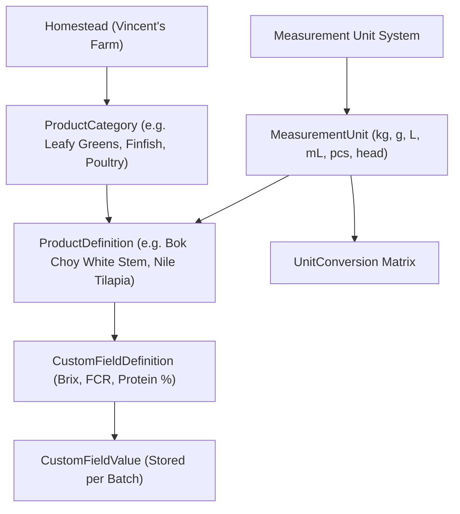
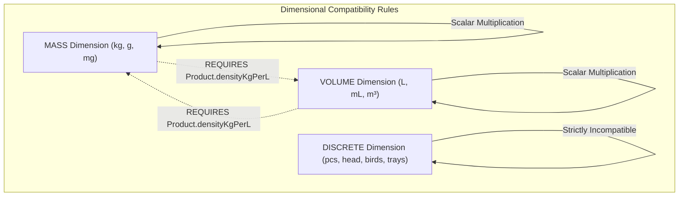

# Product and Unit Catalog Specification — Terra Interface

> **Configuration & Taxonomy Architecture**  
> **Document Version**: 1.0.0 | **Status**: Architecture Specification

---

## 1. Zero Hardcoding Principle

Terra Interface avoids hardcoded enumerations for products, varieties, units, and custom metrics. Because an ecological homestead evolves seasonally (introducing new heritage crops, cross-breeding poultry, or experimenting with alternative insect feeds), the entire taxonomy is driven by **dynamic relational database entities**.



---

## 2. Dynamic Product Taxonomy

### 1. Categories (`ProductCategory`)
Defines the ecological classification of an output or input:
- `CULTIVATION`: Leafy Greens, Fruiting Solanaceae, Fungi & Mushrooms, Perennial Fruit.
- `LIVESTOCK`: Dual-Purpose Poultry, Pastured Meat Birds, Small Ruminants.
- `AQUACULTURE`: Herbivorous Finfish, Carnivorous Sump Fish, Aquatic Plants (Duckweed).
- `CIRCULAR`: Insect Biomass (BSF), Cured Compost, Biochar Inoculant, Fermented Leachate.

### 2. Product Definitions (`ProductDefinition`)
Represents a distinct biological species or agricultural item:
- `name`: Human-readable title (e.g., *California Dwarf Papaya*).
- `sku`: Unique identifier (e.g., `SKU-CUL-PAP-01`).
- `defaultUnitId`: Foreign key to `MeasurementUnit`.
- `densityKgPerL`: Required for any liquid, compost, or bulk grain where volume-mass conversions may occur.

---

## 3. Dimension-Safe Unit Conversion Engine

Unit conversions follow strict dimensional analysis rules to prevent dangerous conversion bugs (e.g., attempting to convert 10 kilograms of kale directly into 10 liters without density calibration):



### Standard Conversion Factors (Same Dimension)

| Source Unit | Target Unit | Multiplier Formula | Physical Dimension |
| :--- | :--- | :--- | :--- |
| `kg` (Kilogram) | `g` (Gram) | $\times 1,000$ | `MASS` |
| `g` (Gram) | `kg` (Kilogram) | $\div 1,000$ | `MASS` |
| `m³` (Cubic Meter) | `L` (Liter) | $\times 1,000$ | `VOLUME` |
| `L` (Liter) | `mL` (Milliliter) | $\times 1,000$ | `VOLUME` |
| `head` (Animal) | `birds` | $\times 1.0$ (Domain alias only) | `DISCRETE` |

### Cross-Dimension Conversion Rule

$$\text{Volume (L)} = \frac{\text{Mass (kg)}}{\rho \text{ (kg/L)}}$$

$$\text{Mass (kg)} = \text{Volume (L)} \times \rho \text{ (kg/L)}$$

If a steward attempts a conversion between a mass unit and a volume unit for a product whose `densityKgPerL` is `NULL`, the backend throws a `400 Bad Request` with message:  
`"Cross-dimension conversion between Mass and Volume requires calibrated density (densityKgPerL) on product."`

---

## 4. Custom Field Definition Engine

To support custom scientific experiments and homestead monitoring without modifying the database schema, stewards can attach custom typed fields to any product definition:

```json
{
  "key": "crude_protein_pct",
  "label": "Crude Protein Content (%)",
  "dataType": "NUMBER",
  "isRequired": false,
  "appliesTo": "ProductCategory.domain == 'CIRCULAR' || 'LIVESTOCK'"
}
```

### Supported Data Types
1. **`NUMBER`**: Floating point numbers validated by min/max bounds (e.g., Brix index 0–32, Protein % 0–100).
2. **`TEXT`**: Short descriptive strings or seed company lot codes.
3. **`BOOLEAN`**: Binary flags (e.g., `is_heritage_breed`, `organic_certified`).
4. **`DATE`**: Calendar dates (e.g., `spore_inoculation_date`).
